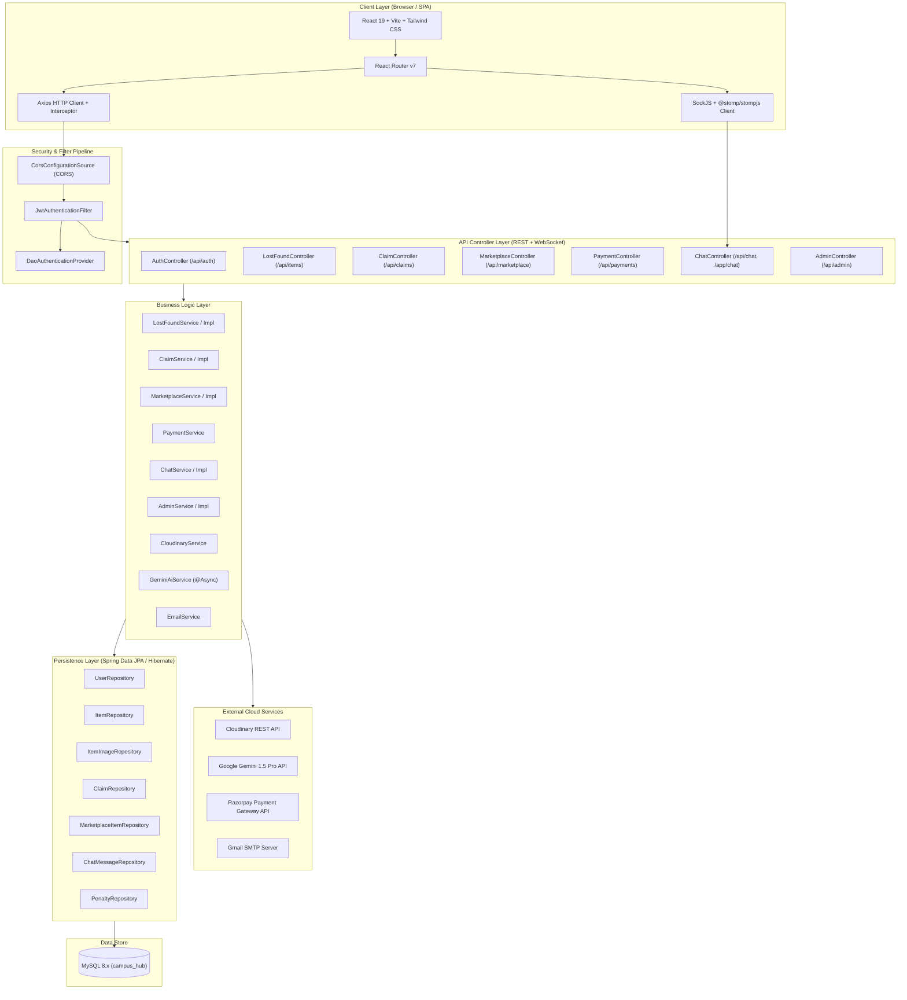
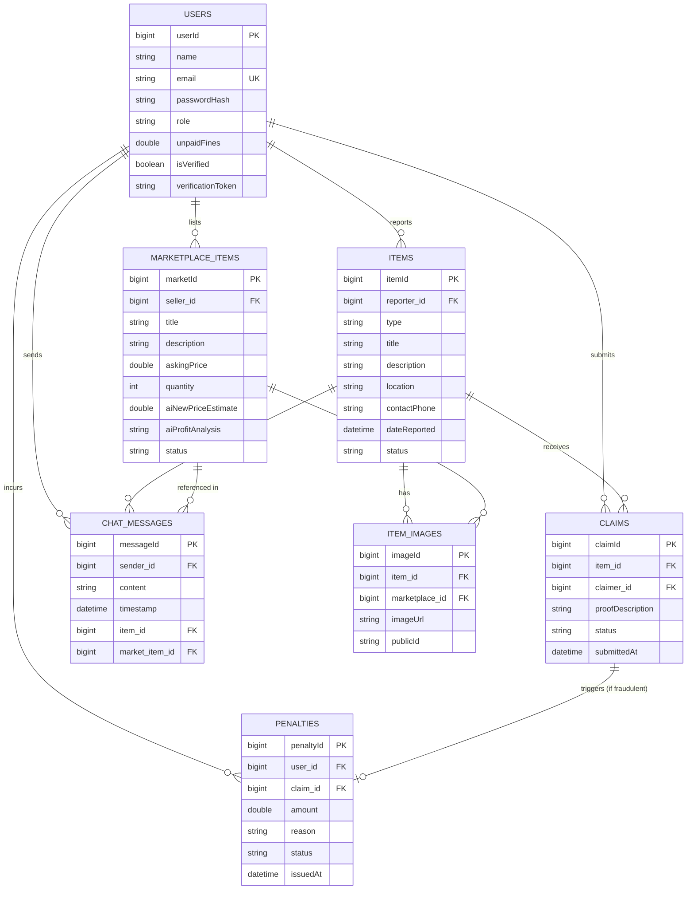
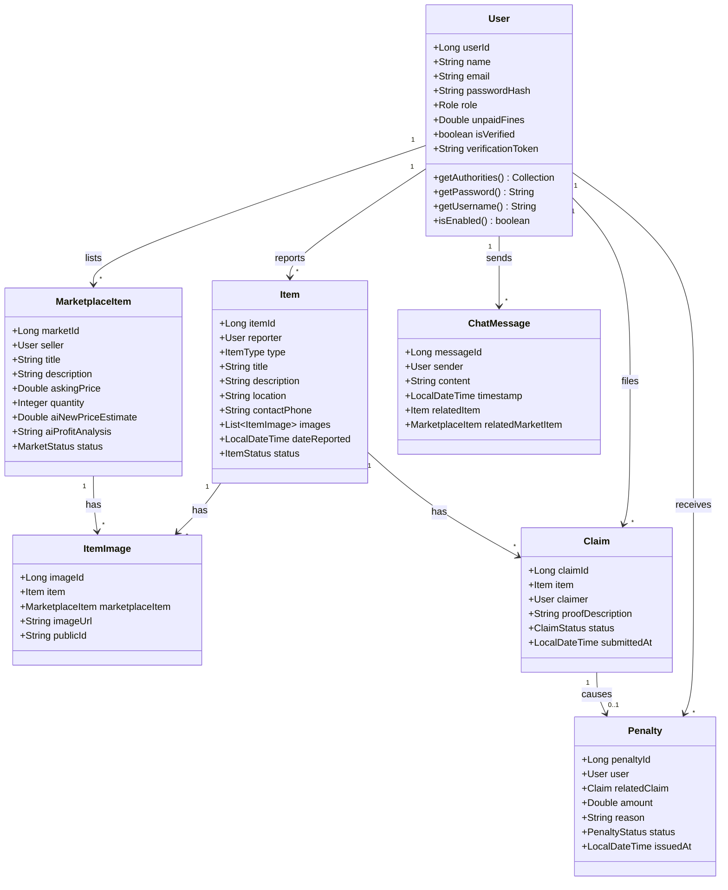
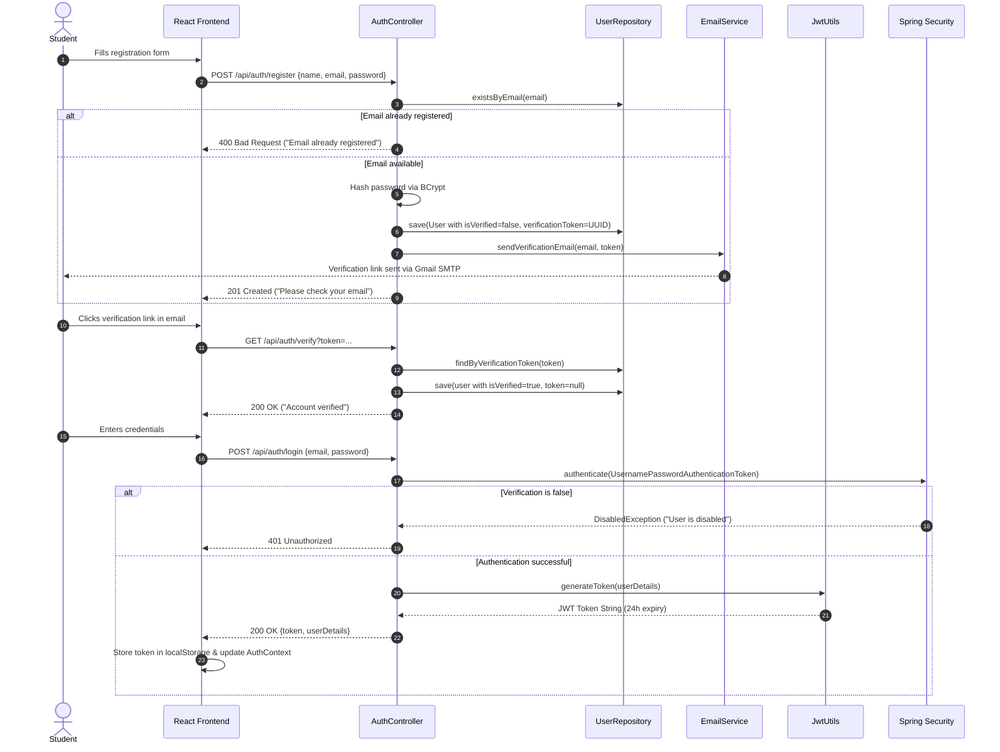
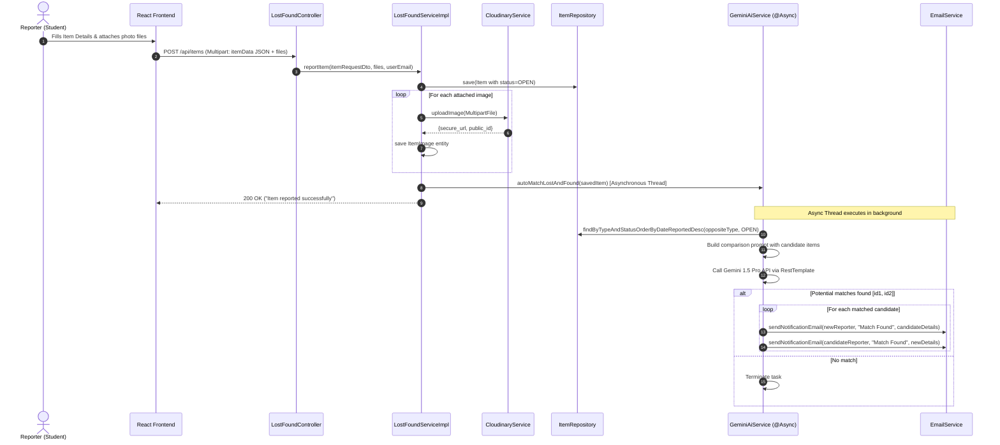
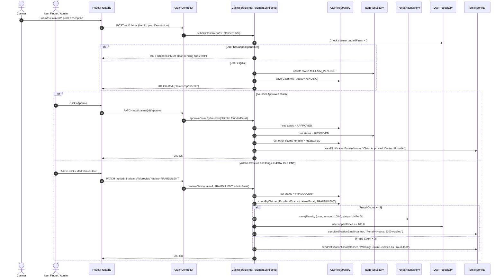
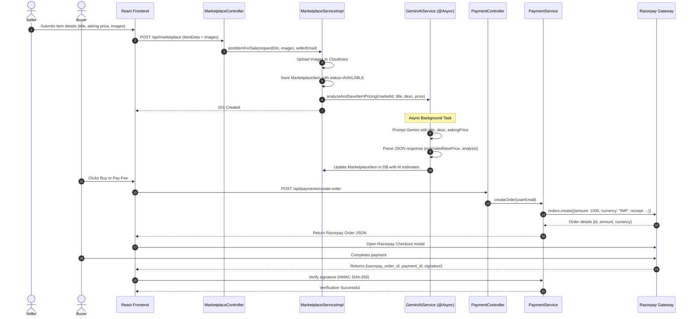
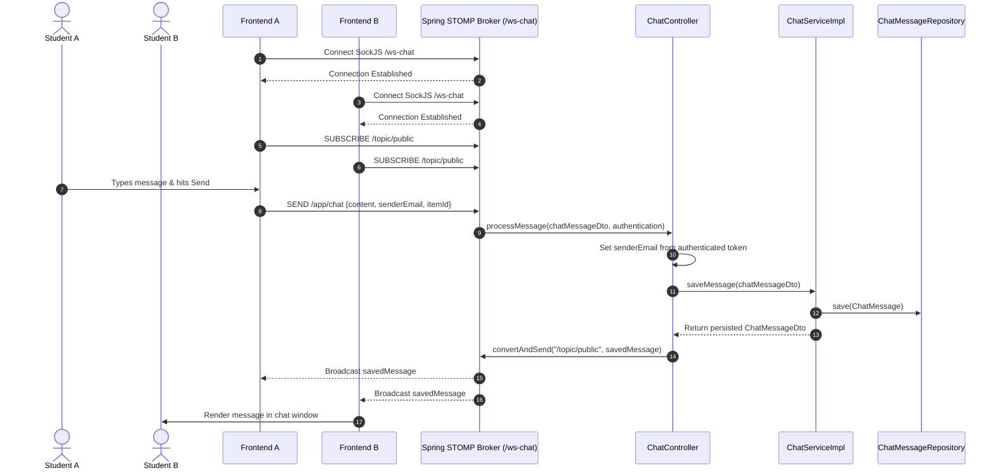
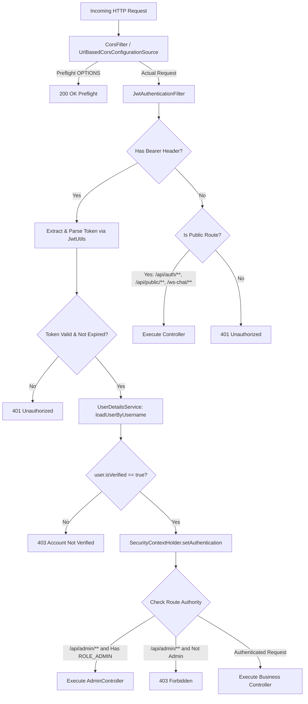

# Low-Level Design (LLD): Campus Hub (Lost & Found & Marketplace)

## 1. Document Overview
This Low-Level Design (LLD) provides an in-depth architectural and structural specification of the **Campus Hub** platform. It covers data models, entity relationships, class hierarchies, sequence diagrams for key user journeys, security filter chains, and integration with third-party providers (Google Gemini AI, Cloudinary, Razorpay, Gmail SMTP, and WebSockets).

---

## 2. High-Level Architectural Layers

The system follows a classic **Layered Clean Architecture** combined with an **Event/Async Pipeline** for external AI and notification tasks.

---

## 3. Database Schema & Entity-Relationship (ER) Design

### 3.1 Entity Relationship Diagram

### 3.2 Enumerations

| Enum Name | Allowed Values | Description |
| :--- | :--- | :--- |
| **`Role`** | `STUDENT`, `ADMIN` | User privilege tier. |
| **`ItemType`** | `LOST`, `FOUND` | Classification for lost & found items. |
| **`ItemStatus`** | `OPEN`, `CLAIM_PENDING`, `RESOLVED` | Operational lifecycle of a lost/found item. |
| **`ClaimStatus`** | `PENDING`, `APPROVED`, `REJECTED`, `FRAUDULENT` | Verification state of a user's claim. |
| **`MarketStatus`** | `AVAILABLE`, `SOLD` | Availability state of a marketplace item. |
| **`PenaltyStatus`**| `UNPAID`, `PAID` | Settlement status of disciplinary fines. |

---

## 4. Class Design & Component Structure

### 4.1 Domain Entities

### 4.2 Repositories & Data Access Interfaces

```mermaid
classDiagram
    class UserRepository {
        <<interface>>
        +findByEmail(email: String) Optional~User~
        +findByVerificationToken(token: String) Optional~User~
        +existsByEmail(email: String) boolean
    }

    class ItemRepository {
        <<interface>>
        +findByTypeAndStatus(type: ItemType, status: ItemStatus, pageable: Pageable) Page~Item~
        +findByTypeAndStatusOrderByDateReportedDesc(type: ItemType, status: ItemStatus) List~Item~
        +searchItemsByKeyword(keyword: String, pageable: Pageable) Page~Item~
        +findByReporter(user: User) List~Item~
    }

    class ItemImageRepository {
        <<interface>>
        +findByItem_ItemId(itemId: Long) List~ItemImage~
        +findByMarketplaceItem_MarketId(marketId: Long) List~ItemImage~
    }

    class ClaimRepository {
        <<interface>>
        +findByItem_ItemId(itemId: Long) List~Claim~
        +findByClaimer_Email(email: String) List~Claim~
        +findByStatus(status: ClaimStatus) List~Claim~
        +countByClaimer_EmailAndStatus(email: String, status: ClaimStatus) long
    }

    class MarketplaceItemRepository {
        <<interface>>
        +findByStatus(status: MarketStatus, pageable: Pageable) Page~MarketplaceItem~
        +findByStatusOrderByMarketIdDesc(status: MarketStatus, pageable: Pageable) Page~MarketplaceItem~
        +searchMarketplaceItems(keyword: String, pageable: Pageable) Page~MarketplaceItem~
        +findBySeller(user: User) List~MarketplaceItem~
    }

    class ChatMessageRepository {
        <<interface>>
        +findTop200ByOrderByTimestampDesc() List~ChatMessage~
        +findByRelatedItem_ItemId(itemId: Long) List~ChatMessage~
    }

    class PenaltyRepository {
        <<interface>>
        +findByUser(user: User) List~Penalty~
        +findByUserAndStatus(user: User, status: PenaltyStatus) List~Penalty~
    }
```

---

## 5. Sequence Diagrams: Core Workflows

### 5.1 User Registration, Verification & Authentication

---

### 5.2 Reporting Item + Cloudinary Upload + Gemini AI Auto-Matching

---

### 5.3 Claim Submission, Founder Approval & 3-Strike Fraud Penalty

---

### 5.4 Marketplace Item Posting, Gemini Valuation & Razorpay Payment

---

### 5.5 Real-Time Chat System via WebSocket & STOMP

---

## 6. Security Architecture & Filter Chain

---

## 7. Design Patterns Applied

| Pattern | Implementation in Codebase | Purpose |
| :--- | :--- | :--- |
| **Builder Pattern** | Lombok `@Builder` on `User`, `Item`, `Claim`, `MarketplaceItem`, `ChatMessage`, `Penalty`. | Fluent, immutable instantiation of complex entities and DTOs. |
| **Repository Pattern** | Spring Data JPA interfaces (`ItemRepository`, `UserRepository`, etc.). | Decouples business layer from data persistence and SQL generation. |
| **Filter / Interceptor Pattern** | `JwtAuthenticationFilter` (backend) & Axios request/response interceptors (frontend). | Centralized, reusable handling of JWT authentication, header injection, and session expiration. |
| **Publish-Subscribe (Pub/Sub)** | Spring WebSocket STOMP Broker (`/topic/public`). | Enables scalable broadcasting of real-time messages to connected room participants. |
| **Adapter / Facade Pattern** | `CloudinaryService`, `PaymentService` (Razorpay), and `GeminiAiService`. | Wraps complex third-party vendor SDKs and APIs into clean domain methods. |
| **Global Exception Handler** | `@RestControllerAdvice` in `GlobalExceptionHandler.java`. | Centralized interception and standardized formatting of runtime errors and validation failures. |

---

## 8. Summary of API Contracts

| Method | Endpoint | Access Tier | Description |
| :--- | :--- | :--- | :--- |
| `POST` | `/api/auth/register` | Public | Register new user account. |
| `POST` | `/api/auth/login` | Public | Authenticate user & return JWT. |
| `GET` | `/api/auth/verify` | Public | Verify user email token. |
| `GET` | `/api/items` | Authenticated | Paginated feed of lost/found items with type & status filters. |
| `POST` | `/api/items` | Authenticated | Report new item with multipart photos; triggers Gemini matching. |
| `GET` | `/api/items/{id}` | Authenticated | Fetch specific item details and associated photos. |
| `DELETE`| `/api/items/{id}` | Reporter Only| Remove item listing. |
| `POST` | `/api/claims` | Authenticated | Submit claim with proof description (blocked if unpaid fines exist). |
| `PATCH`| `/api/claims/{id}/approve` | Item Founder | Founder approves claim and marks item resolved. |
| `PATCH`| `/api/claims/{id}/reject` | Item Founder | Founder rejects insufficient claim. |
| `GET` | `/api/marketplace` | Authenticated | Paginated listings of available items for sale. |
| `POST` | `/api/marketplace` | Authenticated | List item for sale; triggers Gemini deal appraisal. |
| `POST` | `/api/payments/create-order`| Authenticated | Initialize Razorpay order. |
| `GET` | `/api/chat/history` | Authenticated | Fetch last 200 messages for global room. |
| `WS` | `/app/chat` -> `/topic/public` | Connected | Send & broadcast real-time messages. |
| `GET` | `/api/admin/claims/pending` | Admin Only | View all unresolved claims. |
| `PATCH`| `/api/admin/claims/{id}/review` | Admin Only | Review claim, approve, or mark fraudulent (penalizes on 3rd strike). |
| `PATCH`| `/api/admin/penalties/{id}/waive`| Admin Only | Waive individual penalty fine. |
